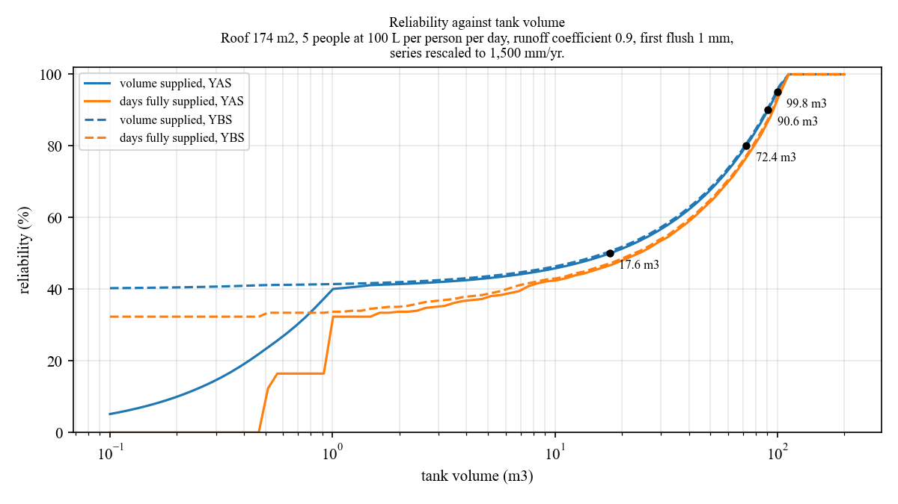
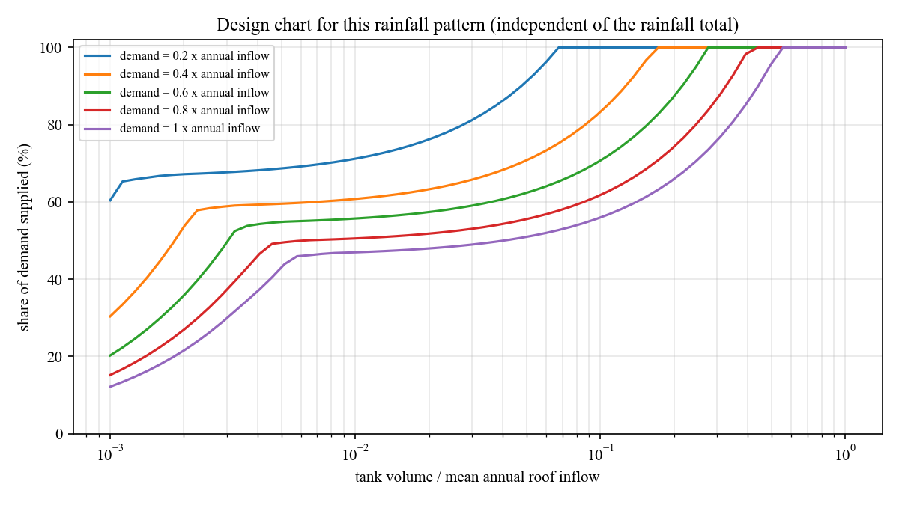
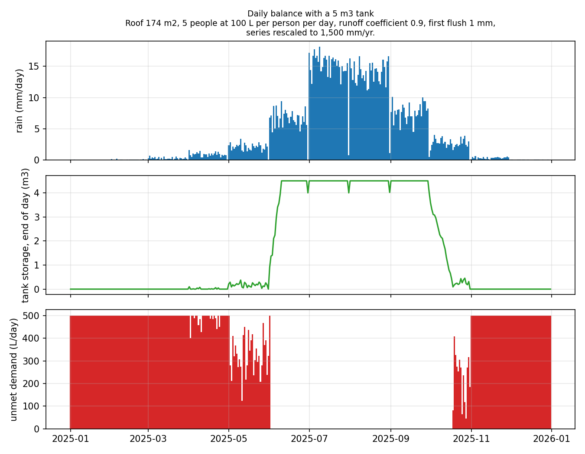

# Rooftop rainwater harvesting: rainfall checks and tank simulation

Python code that checks an hourly rainfall record, simulates a household rainwater tank day by
day, and estimates how much of the roof runoff from 20,000 buildings could actually be used.

## Data and its limits

| File | Content |
|---|---|
| `Precipitation_Data.csv` | Hourly rainfall for 2025; the file labels its location "Sample Area" |
| `Building_Rooftop_Area_Data.csv` | Rooftop areas of 20,000 buildings, 50 to 299 m2, median 174 m2 |

The rainfall file is a sample pattern, not a gauge record. The quality checks in this repository
show why:

- its annual total is 64,383 mm, 2.43 times the world record of 26,470 mm (Cherrapunji, 1860-61);
- the last day of every month has one hourly record instead of 24 (12 days, 96.8 % coverage).

The analysis therefore keeps the day-to-day pattern of the series and rescales it to a stated
annual total. The results below use 1,500 mm per year, a round figure close to the annual rainfall
of the Kathmandu Valley. They show what the method gives for a strongly monsoonal pattern; they
are not a design for a real site. To analyse a real site, replace the CSV with a gauge record and
leave out `--annual-total`; the script then uses the record as it is and warns if its total is
not physically possible.

## Method

1. **Quality control.** Hourly values are summed to days. The report gives the coverage, the
   days with missing hours, the annual total and its ratio to the world record.
2. **Rainfall statistics.** Monthly totals, wet days (at least 1 mm), the longest dry spell, the
   seasonal shares (winter Dec-Feb, pre-monsoon Mar-May, monsoon Jun-Sep, post-monsoon Oct-Nov)
   and the precipitation concentration index (Oliver, 1980).
3. **Roof inflow.** `Q = C x A x max(R - f, 0)` litres per day, with runoff coefficient `C`, roof
   area `A` in m2, daily rainfall `R` in mm and a first-flush loss `f` in mm. One millimetre of
   rain on one square metre is one litre.
4. **Tank balance.** For storage `S`, demand `D`, yield `Y` and tank volume `V`:
   - yield after spillage (YAS): `Y = min(D, S_prev)`, then `S = min(S_prev + Q, V) - Y`
   - yield before spillage (YBS): `Y = min(D, S_prev + Q)`, then `S = min(S_prev + Q - Y, V)`

   YAS is the conservative rule and is used for the results; YBS gives the upper bound (Fewkes
   and Butler, 2000). The record is repeated until the tank starts a pass at the level at which
   it ended the previous one, so the result does not depend on an assumed starting level.
5. **Performance.** Share of the demand volume supplied, share of days fully supplied, and share
   of the roof inflow that overflows. Every run is checked for mass balance.
6. **Design chart.** The same balance with the tank volume and the annual demand expressed as
   fractions of the mean annual roof inflow. In this form the chart depends only on the rainfall
   pattern, not on the rainfall total or the roof area.
7. **All buildings.** Each building gets the same household demand and tank; the script reports
   the roof inflow and the supply for every building and their totals.

## Results

Produced by `python run_analysis.py --annual-total 1500`; all tables are in
[results/summary.md](results/summary.md).

**Rainfall pattern.** 86.7 % of the annual rainfall falls in June to September. The
precipitation concentration index is 21.8; values above 20 indicate a strongly seasonal
distribution. No day from November to March reaches 1 mm. Together with 31 October, which has a
single hourly record, the dry spell lasts 152 days.

**Reference household.** Roof 174 m2, five people at 100 litres per person per day, runoff
coefficient 0.9, first flush 1 mm, 5,000-litre tank.

| Quantity | Value |
|---|---|
| Roof inflow | 198.9 m3 per year |
| Demand | 182.5 m3 per year |
| Supplied from the tank | 78.6 m3 per year |
| Share of demand supplied | 43.1 % (43.6 % under YBS) |
| Days fully supplied | 37.8 % |
| Share of roof inflow that overflows | 60.5 % |

| Share of demand supplied | Tank volume needed |
|---|---|
| 50 % | 17.6 m3 |
| 80 % | 72.4 m3 |
| 90 % | 90.6 m3 |
| 95 % | 99.8 m3 |



What the numbers show:

- The roof receives more water in a year than the household uses, yet a 5 m3 tank supplies less
  than half of the demand, because most of the inflow arrives when the tank is already full.
- Supplying 90 % of the demand needs about 90 m3 of storage. The 152-day dry spell alone takes
  76 m3 at 0.5 m3 per day.
- The runoff coefficient matters little once the tank is the limit: raising it from 0.6 to 0.9
  increases the roof inflow by 50 % but the share of demand supplied only from 40.5 % to 43.1 %.
- For the same reason a larger roof adds little. Above about 100 m2 the supply from a 5 m3 tank
  rises only slowly with roof area ([plot](plots/yield_vs_roof_area.png)).

**All 20,000 buildings**, each with the reference demand and a 5,000-litre tank:

| Quantity | Value |
|---|---|
| Total rooftop area | 3.48 km2 |
| Total roof inflow | 3.98 million m3 per year |
| Total supplied from the tanks | 1.55 million m3 per year |
| Share of roof inflow that is used | 38.9 % |
| Share of total demand supplied | 42.4 % |





Other plots: [monthly rainfall](plots/monthly_rainfall.png),
[seasonal share](plots/seasonal_contribution.png),
[cumulative rainfall](plots/cumulative_rainfall.png),
[wet-day distribution](plots/rainfall_distribution.png),
[wet-day rainfall by month](plots/rainfall_boxplot.png),
[runoff coefficient](plots/efficiency_simulation.png).

## Running

```bash
pip install -r requirements.txt
python run_analysis.py --annual-total 1500    # the results shown above
python run_analysis.py                        # the rainfall record as supplied
python -m unittest discover -s tests          # 18 checks
```

| Option | Default | Meaning |
|---|---|---|
| `--rainfall` | `Precipitation_Data.csv` | hourly rainfall CSV with `DateTime` and `Rainfall (mm/hr)` columns |
| `--rooftops` | `Building_Rooftop_Area_Data.csv` | building id and rooftop area (m2) in the first two columns |
| `--annual-total` | none | rescale the rainfall series to this annual total in mm |
| `--occupants` | 5 | people per household |
| `--demand` | 100 | litres per person per day |
| `--runoff` | 0.9 | roof runoff coefficient |
| `--first-flush` | 1.0 | mm of each rain day diverted from the tank |
| `--tank` | 5000 | reference tank volume in litres |

Outputs: `results/summary.json` and `results/summary.md`, ten plots in `plots/`,
`daily_rainfall.csv` (recorded and analysed daily totals with the number of hourly records) and
`rainwater_potential.csv` (roof inflow, supply and share of demand supplied for every building).

## Layout

```
rwh/data.py        loading, quality control, rainfall statistics, rescaling
rwh/model.py       roof inflow, tank balance, tank sizing, design chart
run_analysis.py    full analysis, plots and result tables
tests/             unit tests
legacy/            the original script
```

## Limits

- One year of rainfall cannot describe year-to-year variability. A real design needs at least
  ten years of daily records.
- The balance uses a daily step and a constant demand, and ignores evaporation and leakage.
- Every building is given the same household demand and tank size.

## Change from the first version

The original script (`legacy/rainfall.py`) reported the annual roof potential only. Its
`Total_Collection_L` column was divided by 1,000 and so held cubic metres; the new
`rainwater_potential.csv` is in litres.

## References

- Fewkes, A., and Butler, D. (2000). Simulating the performance of rainwater collection and reuse
  systems using behavioural models. Building Services Engineering Research and Technology, 21(2), 99-106.
- Oliver, J. E. (1980). Monthly precipitation distribution: a comparative index. The Professional
  Geographer, 32(3), 300-309.
- World Meteorological Organization, World Weather and Climate Extremes Archive.

## Author

Bibek Subedi, 078bce035.bibek@pcampus.edu.np
